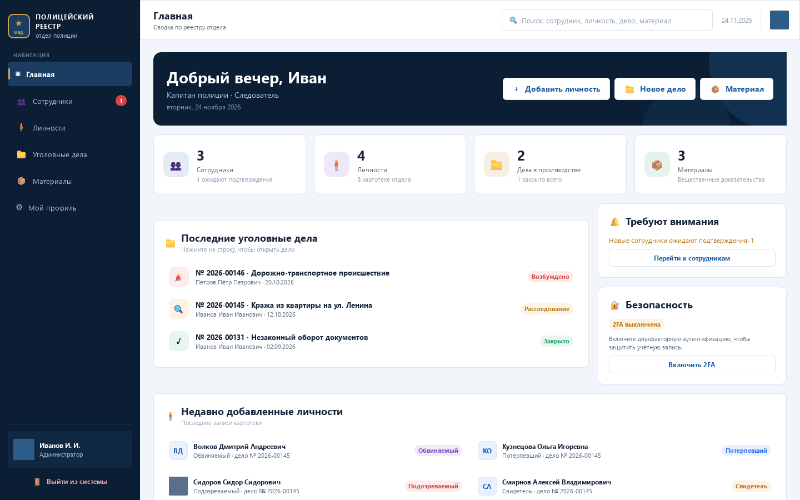
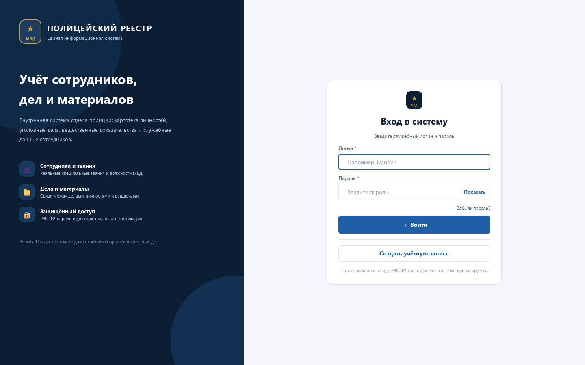
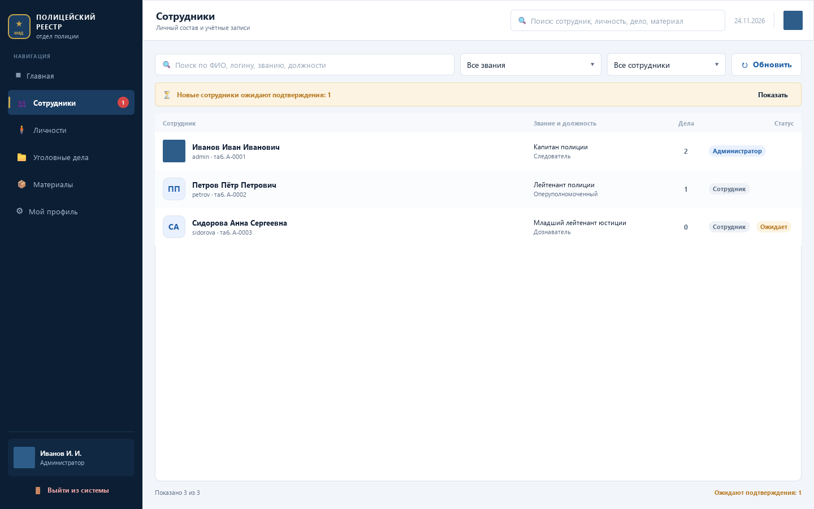
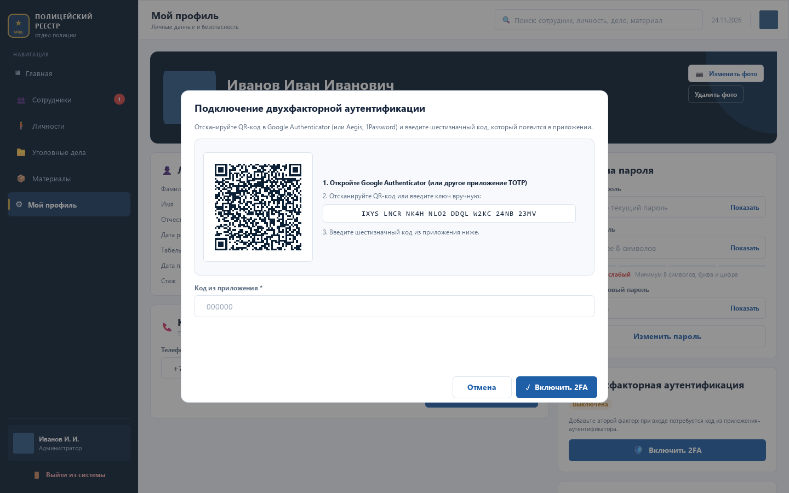
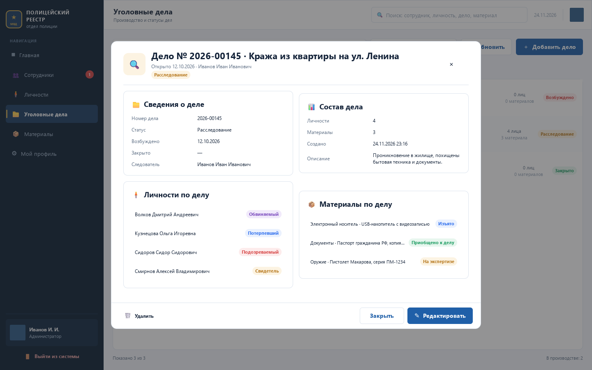

# Полицейский реестр

Десктопная информационная система отдела полиции: учёт сотрудников, картотека
личностей, уголовные дела и вещественные доказательства. Написана на C++/Qt 6
(Qt Quick/QML) с локальной базой SQLite.

> Учебный проект. Не является официальной системой МВД и не
> предназначен для обработки реальных персональных данных без дополнительной
> защиты и организационных мер.



## Возможности

### Доступ и безопасность

- вход по служебному логину и паролю;
- пароли хранятся как PBKDF2-HMAC-SHA256 (210 000 итераций, случайная соль);
  старые хэши автоматически обновляются при входе;
- блокировка входа на 5 минут после 5 неудачных попыток;
- двухфакторная аутентификация (TOTP, RFC 6238) для Google Authenticator,
  Aegis, 1Password и других приложений;
- QR-код и ключ для ручного ввода, 8 одноразовых резервных кодов;
- роли «администратор» и «сотрудник»;
- первый зарегистрированный пользователь становится администратором,
  остальные учётные записи ожидают подтверждения;
- администратор может выдать сотруднику временный пароль и отключить 2FA,
  если устройство с приложением потеряно;
- смена пароля и управление 2FA в профиле.

### Сотрудники

- карточка сотрудника: фото, личные и служебные данные, стаж, последний вход;
- реальные специальные звания МВД по категориям «Полиция», «Внутренняя
  служба», «Юстиция» (от рядового до генерала);
- типовые должности подразделений: руководство, уголовный розыск, следствие
  и дознание, участковые, ППС, ДПС, ПДН, эксперты, кадры, дежурная часть;
- поиск и фильтры по званию, должности и статусу учётной записи;
- подтверждение заявок, назначение администраторов, удаление сотрудников;
- фотографии копируются в каталог приложения и не зависят от исходного файла.

### Личности, дела и материалы

- картотека личностей: статус (подозреваемый, обвиняемый, свидетель,
  потерпевший), судимость, адрес, телефон, описание, фото;
- привязка личности к уголовному делу;
- дела: номер, название, описание, даты, статус, следователь, связанные
  личности и материалы;
- вещественные доказательства: тип, статус, место хранения, дело, кто принял;
- каскадное удаление дела с подтверждением: материалы удаляются, личности
  остаются в картотеке без дела;
- поиск по каждому разделу и глобальный поиск в шапке.

### Интерфейс

- единая тема и переиспользуемые компоненты (`qml/Theme.qml`,
  `qml/components/`);
- адаптивная оболочка: боковая навигация, шапка, дашборд;
- карточки-диалоги вместо перезагрузки страниц;
- уведомления, пустые состояния, подтверждения опасных действий;
- кастомный календарь, не зависящий от стиля Qt Quick Controls.

## Скриншоты

| Вход | Сотрудники |
| --- | --- |
|  |  |

| Настройка 2FA | Карточка дела |
| --- | --- |
|  |  |

## Стек

- C++17;
- Qt 6.8+ (Quick, QML, Quick Controls 2, SQL, Network);
- SQLite (драйвер QSQLITE, WAL, внешние ключи);
- CMake 3.21+;
- [qrcodegen](https://www.nayuki.io/page/qr-code-generator-library) (MIT) для
  QR-кода 2FA.

Стек намеренно не менялся: это по-прежнему Qt Quick + SQLite.

## Сборка

### Windows (Qt 6.12, MinGW)

```powershell
cmake -S . -B build -G "MinGW Makefiles" `
      -DCMAKE_PREFIX_PATH=C:/Qt/6.12.0/mingw_64 `
      -DCMAKE_BUILD_TYPE=Release
cmake --build build -j
```

Перед запуском добавьте в `PATH` каталоги `C:\Qt\6.12.0\mingw_64\bin` и
`C:\Qt\Tools\mingw1310_64\bin`. Для переносимой сборки:

```powershell
windeployqt build/apppolicedep.exe
```

### Linux / macOS

```bash
cmake -S . -B build -G Ninja -DCMAKE_PREFIX_PATH=/path/to/Qt/6.12.0/gcc_64
cmake --build build
./build/apppolicedep
```

## Запуск и данные

- При первом запуске зарегистрируйте сотрудника — он получит права
  администратора.
- Последующие регистрации создаются со статусом «Ожидает подтверждения»:
  администратор подтверждает их в разделе «Сотрудники».
- База данных создаётся в каталоге данных пользователя, путь печатается в
  консоль при старте. На Windows это обычно
  `%USERPROFILE%\AppData\LocalLow\PoliceRegistry\policedepartment.db`.
- Рядом с базой создаётся каталог `photos/` для фотографий.
- Удаление файла базы сбрасывает систему к состоянию первого запуска.

Схема БД версионируется через `PRAGMA user_version`; при обновлении со старой
версии выполняется миграция (добавляются колонки, индексы, роли и 2FA-поля).

## Структура проекта

```text
main.cpp                     точка входа, стиль, контекст QML
src/
  DatabaseManager.*          сессия, SQLite, миграции, CRUD, 2FA, фото
  ReferenceData.*            звания, должности, статусы, типы материалов
  TotpAuth.*                 TOTP, Base32, резервные коды
  QrCodeItem.*               отрисовка QR в QML
  PhotoImageProvider.*       фотографии: кэш, кроп, скругление
  SelfTest.*                 консольные проверки логики
  UiSmoke.*                  скриншоты разделов для проверки UI
  third_party/qrcodegen.*    генератор QR-кода (MIT)
qml/
  Main.qml                   окно входа/регистрации/приложения
  Theme.qml                  палитра, типографика, форматирование
  App.qml                    сессия, навигация, уведомления
  components/                кнопки, поля, карточки, диалоги, поиск
  pages/                     экраны и карточки-диалоги
docs/screenshots/            скриншоты интерфейса
```

## Проверки

Логика БД, регистрации, ролей, 2FA и фотографий покрыта консольным
self-test (отдельная цель `policedep_selftest`):

```powershell
$env:QT_QPA_PLATFORM = "offscreen"
.\build\policedep_selftest.exe
```

Для проверки QML и вёрстки есть служебный режим, который создаёт временную
базу с демонстрационными данными, проходит по разделам и сохраняет скриншоты
в `build/ui-smoke/`:

```powershell
$env:QT_QPA_PLATFORM = "offscreen"
$env:QT_QPA_FONTDIR = "C:/Windows/Fonts"
.\build\apppolicedep.exe --ui-smoke
```

Оба режима не трогают рабочую базу.

## Безопасность и ограничения

- SQLite-файл не шифруется; для реальных данных используйте BitLocker/LUKS
  или переходите на серверную СУБД.
- Секрет TOTP хранится в базе в открытом виде (это необходимо для проверки
  кода); доступ к файлу БД должен быть ограничен.
- Нет журнала аудита действий, восстановления пароля по почте и синхронизации
  между рабочими местами.
- Резервное копирование — вручную: копируйте `.db` и каталог `photos/` при
  остановленном приложении.

Дальнейшие шаги: PostgreSQL + серверная авторизация, журнал аудита,
разграничение прав по подразделениям, экспорт отчётов, резервное копирование.

## Лицензии

Сторонние компоненты перечислены в [THIRD_PARTY_NOTICES.md](THIRD_PARTY_NOTICES.md).
